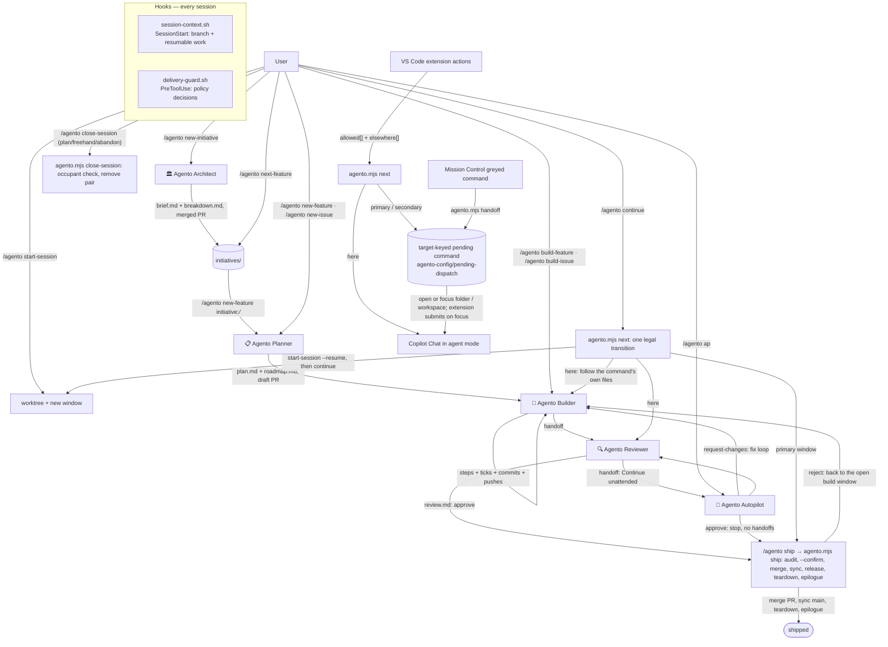

# Architecture



## Pieces

- **Prompts** (`.github/prompts/`) are the slash commands. They are thin: they set
  expectations and dispatch to an agent.
- **Router skill** (`skills/agento/SKILL.md`) resolves `/agento <name>` in every
  session (Copilot and Local) — neither harness loads the plugin's prompt commands,
  so the router is the only `/agento` path. It is installed as the user-level link
  `~/.copilot/skills/agento` (by the `harness install` subcommand, below), reads
  `skills/agento/commands/<name>.md`, and dispatches by that file's `agent:`
  frontmatter — inline for missing/`agent` and for Planner, Architect, Mechanic,
  and Autopilot; a subagent for Builder and Reviewer.
- **Agents** (`.github/agents/`) hold the durable behavior: the Architect's brief
  decomposition and self-contained publish, the Planner's resume protocol and
  dependency-gated initiative intake, the Builder's work loop and verification
  gates, review scoring, autopilot orchestration, and the mechanic that maintains
  the system itself.
- **Instructions** (`.github/instructions/`) are contracts. Only two apply to every
  request (`applyTo: "**"`): the **always-on core** (`agento-core.instructions.md`,
  ≤ 40 lines — where the policy lives and when to read it, the work boundary,
  secrets, git musts, the receipt one-liner, and the canonical spelling and redirect
  rule for slash commands: `/agento <name>`; old forms are read as the canonical
  command and proceed without confirmation) and **ai-skills** (the skills-first
  policy). The **delivery policy** (`delivery-policy.instructions.md`) is loaded on
  demand: every agent and command declares the sections it loads on a `Policy: §…`
  line and loads exactly those with `node <agento-root>/scripts/agento.mjs policy
  <N>…` (an uncited section loads on demand with `agento.mjs policy N`), and it
  auto-attaches only while Agento's own agents, prompts, commands, and instructions
  are edited. It is the
  single source for the rules every role shares — who does the work, verification
  targets, manual/post-ship steps and evidence, the lint gate, shell hygiene, git
  rules, the cross-window handoff, and execution receipts with per-command
  idempotency (every command opens with a receipt line carrying a deterministic
  operation ID and closes with a result line; a duplicate submission resumes from git
  + roadmap state), capability preflight (§10: every command and agent declares
  `Needs:`/`Fallback:`; `agento.mjs doctor --for <name>` runs before the first write
  of any command needing `gh`, `code`, or `network`; the opening
  `agento.mjs preflight <command>` prints a brief document, `--full` returning the
  whole record), and the window check (§11: every
  command names the `role` it requires and checks it against `agento.mjs session` — a
  mismatch is a `rejected` receipt with the record's alternatives; the roles table
  itself lives in the CLI), and command presentation (§12: every `/agento …`
  command a response asks the user to run is emitted as its own one-command fenced
  block with no language tag, giving it a copy button in chat); agents and prompts
  cite its numbered sections
  (`§2`) instead of restating them, and a test fails if a rule is spelled out twice.
  The **artifact contract** holds only formats; **concurrent-delivery** holds only
  mechanics (ports, previews, shared resources, integration recipes).
- **Hooks** run outside the model. `session-context.sh` injects branch, resumable
  work, and the Agento CLI path at session start; `delivery-guard.sh` can
  `allow`/`ask`/`deny` any tool call (default-branch protection, force-push and hook
  bypasses, open-ended watchers, ruleset-bypassing merges, hook self-protection,
  worktree-occupant detection). The guard is a slip guard for the model, not an
  enforcement boundary — that is the GitHub ruleset on the default branch.
- **Scripts** are the deterministic helpers, fronted by `scripts/agento.mjs`: the
  config loader, the roadmap resolver (local search with origin fallback and
  branch-header validation), the status lister, the initiative deriver (per-member
  state, `blockedBy`, waves, and `next` computed from member roadmaps — the
  breakdown itself holds no progress), worktree path and per-slug port
  derivation, the session start and close (`start-session`, and `close-session`
  with its own worktree-occupant check in `scripts/worktree-occupants.mjs` — the
  guard cannot see a removal made inside the CLI), the ship state machine
  (`agento.mjs ship`: the read-only audit with its confirmation token, the
  `--confirm` writes, both merges, the default syncs, the release wait, the
  teardown through the same occupant gate, and the post-ship epilogue — every phase
  derived from git and GitHub state so a re-send resumes), the Builder's git
  choreography (`agento.mjs sync` integrates both halves by merge;
  `agento.mjs step-commit` performs the two-commit rule with the roadmap tick,
  integrates, pushes product then companion, and opens missing draft PRs — both
  enforce the guard's rules in process, since the guard cannot see their git), the
  Planner's and Reviewer's publish (`agento.mjs plan-publish` commits the plan and
  opens the draft PRs; `agento.mjs review-publish` commits the review and upserts one
  marked verdict comment on the code PR), the changes-branch flows' publish
  (`agento.mjs publish-pr` pushes, opens a non-draft PR, waits within a bounded
  budget, merges with `--merge` only, deletes the branch, and syncs the default —
  refusing the default branch and every delivery prefix, which merge only through
  ship), the
  bounded CI poller,
  and the guard replay harness. The `harness` subcommand
  (`agento.mjs harness install|status|uninstall`, with the pure link helpers in
  `scripts/harness.mjs`) creates, reports, and removes the
  `~/.copilot/skills/agento` router link, and the doctor `harness` check reports
  its state. Prompts call the
  CLI rather than re-deriving these algorithms in prose, so the configured branch
  names and artifact roots are honoured everywhere the hooks honour them.
- **Extension** (`extension/`) renders CLI state and dispatches only the command
  records supplied by `allowed[]` and `elsewhere[]`. It revalidates delivery actions
  through `agento.mjs next <slug>`; same-window routes open Copilot Chat with the
  canonical query in agent mode. Cross-window routes persist `/agento continue
  <slug>` under the exact CLI target, prefer the generated `.code-workspace` for a
  companion pair, and open the target window. That window atomically consumes the
  record on activation or focus before submission. Records expire after five
  minutes; invalid, mismatched, or failed handoffs are surfaced without submission.
  The extension can focus another window but cannot read or cancel that window's
  chat through the public VS Code API.

## Policy reference: receipts, preflight, and window check

The detailed mechanics behind the receipts, capability preflight, and window check
rules. The delivery policy (§9, §10, §11) keeps only the model-performed clauses and
points here; the 🛠️ Agento Mechanic reads the §10 authoring contract here when it
creates or edits a command.

### §9 Execution receipts

**Receipt — the first line of the response:**

- `Receipt: accepted <op-id>` — work starts.
- `Receipt: accepted <op-id> (duplicate of <op-id>; resuming)` — the same operation
  was already submitted; the command resumes per its duplicate-submission line and creates
  nothing a second time.
- `Receipt: rejected — <reason>; allowed: <cmd>[, <cmd>…]` — nothing is written. The
  alternatives are copied from the session record (`agento.mjs session`, echoed by
  the SessionStart hook's `Session:` line): every `allowed[]` entry verbatim, then
  each `elsewhere[]` entry as `<cmd> (<window> window)`. Commands never hand-maintain
  alternative lists.
- `Receipt: rejected — <capability>: <reason>; fallback: <fallback>` — nothing is
  written; a *hard* need from the command's `Needs:` line is unmet (§10). There is no
  `allowed:` list because the command is right and the environment is not; `<reason>`
  and `<fallback>` are the `detail` and `fallback` of the failing `doctor` check, or
  the §10 standard fallback for a chat capability.

**Preflight — an optional second line, directly after an `accepted` receipt:**

- `Preflight: <capability> <warn|missing> — <fallback>` — one line per unmet *soft*
  need (§10), quoting the `doctor` check's `fallback` or the §10 standard fallback
  verbatim. The command then proceeds using that fallback. No line is printed when
  every need is met.

**Result — the last line of the response:**

- `Result: completed — <resulting state>; next: <command>` — state names the branch,
  PR, roadmap `status`, or lifecycle as applicable; `next:` is the concrete next
  command and is how the AGENTS.md "ends with a concrete suggested next step" rule is
  satisfied.
- `Result: failed — <retry-safe explanation>` — what was done, what was not, and that
  re-sending the same command resumes from git + roadmap state (or what must change
  first). A pause (manual step or blocker awaiting the user) is a `completed` result
  whose state is `paused`, and a session break (§3 pause kinds) a `completed` result
  whose state is `in-progress`; both name the resume command in `next:` and neither
  is a failure.

**Operation ID** — `<command>:<subject>:<short-sha>`:

- `<command>` is the suffix-less command name (`new-feature`, `ship`, `ap`).
- `<subject>` is the slug when the command takes one; else the session id of a
  managed worktree (`plan-<id>`); else the current branch name (`git branch
  --show-current`, e.g. `delivery-status:main:e0bbddf`); else, detached and unmanaged,
  the literal `HEAD`.
- `<short-sha>` is `git rev-parse --short HEAD` at acceptance.

`node <agento-root>/scripts/agento.mjs preflight <command> [<type> <slug>]` derives
the ID (`opId`, with its `subject`) and returns the receipt and preflight lines ready
to print (`receipt`, `preflightLines`) in the spellings above; commands print them
verbatim instead of assembling them. A duplicate submission prints the duplicate
form of the accepted receipt with that `opId`.

The ID is deterministic: the same command on the same subject at the same HEAD is a
duplicate submission and receives the duplicate receipt. Nothing is persisted; the
command recognises the duplicate from what the first submission left in git and the
roadmap.

**Idempotency table** — what a duplicate submission does, per command:

| Command | Duplicate submission |
| --- | --- |
| `/agento new-feature`, `/agento new-issue` | An existing roadmap for the slug enters the Planner resume protocol; no second branch, worktree, or PR. An existing GitHub issue is linked, not duplicated. |
| `/agento build-feature`, `/agento build-issue` | The Builder resume/audit protocol on the existing branch and roadmap; ticked steps are audited, never redone. |
| `/agento review-feature`, `/agento review-issue` | A fresh verdict overwrites review.md; no second PR comment thread. |
| `/agento ship` | `status: complete` with unticked post-ship steps resumes at the epilogue; `status: complete`, PR merged, and a managed worktree still owning the branch resumes at teardown; an already-merged PR with no worktree only syncs the default branch and reports it; in companion mode, a code PR merged while the companion PR is still open resumes at the companion merge, then sync, teardown, epilogue; a conflict or a failing required check found at `checks` reopens the roadmap to `in-progress` with an added Builder step and rejects back to the build window, while a policy-blocked merge (`mergeStateStatus: BLOCKED` or a refusal that classifies as blocked) reports `merge-blocked` and does not reopen. |
| `/agento ap` | Re-enters the build or review resume protocol wherever the roadmap stands. |
| `/agento continue` | Re-derives the transition from git + roadmap state and performs whatever is legal now; never a second worktree, branch, or PR — the dispatched command's own row governs the rest. |
| `/agento start-session`, `/agento start-freehand` | A registered worktree for the same subject is resumed with `--resume` semantics whether or not the flag was given: HEAD, branch, and files untouched, the window reopened. |
| `/agento close-session` | A worktree already removed is reported as already closed; a merged local branch is still deleted and worktrees pruned. |
| `/agento finish-freehand`, `/agento commit-current-changes` | The existing commit, PR, or check-wait phase is reused; never a second commit or PR for the same changes. |
| `/agento quick-fix` | An open PR on `changes/<slug>` from the same base is resumed; the `-2`, `-3` suffix applies only when that branch's PR is merged or closed. |
| `/agento new-initiative` | An open `changes/initiative-<slug>` PR is resumed; a merged one is rejected naming the existing breakdown. |
| `/agento agento-init` | Existing files are kept unless `--force`; an existing companion repository or clone is adopted, never recreated or reset. With `--migrate`, roots already moved report nothing to migrate and existing `changes/agento-init` PRs in either repository are resumed, never duplicated. |
| `/agento install-skills` | Already-installed skills are excluded from the batch. |
| `/agento triage-followups` | Already-annotated follow-up lines and already-flagged issues are skipped. |
| `/agento delivery-status`, `/agento next-feature`, `/agento doctor` | Read-only; a duplicate is a fresh read (for `doctor`, a fresh run of the checks). |
| `/agento models` | `apply` of the already-active profile and `clear` on an unpinned clone change nothing (`changed: []`); `init` with the file present reports `created: false`; `list` and `show` are reads. |
| `/agento mission-control` | A fresh open — reopening the canvas with the same `instanceId` reuses the live instance. |
| `/agento extend-copilot`, `/agento fix-copilot` | An existing capability with the same name is modified in place, never duplicated. |

### §10 Capability preflight

**Vocabulary** — the only tokens a `Needs:` line may use:

- `terminal` — a shell the agent can run commands in (Agent mode; Plan and Ask chat
  modes have none).
- `ask-questions` — the structured ask-questions chat tool (`vscode/askQuestions` in
  an agent's `tools:`) for clarification.
- `browser` — the integrated browser tools for driving a URL and capturing state.
- `gh` — the GitHub CLI, installed and authenticated (`doctor` check `gh`).
- `code` — the VS Code CLI for opening a worktree window (`doctor` check `code`).
- `network` — the `origin` remote reachable for fetch, push, PR, and package
  installs (`doctor` check `git-remote`).

No token stands for Node: Node ≥ 20 runs the CLI and both hooks (the delivery guard
and SessionStart context) and is part of `terminal` (`doctor` check `node`). Without
it the hooks are silent — no guard, no session context — and `doctor` fails `node`.

**Hard versus soft.** `terminal` is hard for every command that runs anything; `gh`
and `network` are hard for every command that pushes, opens or merges a PR, or files
an issue. `ask-questions`, `browser`, and `code` are soft: the command
proceeds with the fallback. A hard need unmet → the §9 preflight rejection receipt;
a soft need unmet → the §9 `Preflight:` line, then proceed.

**Declaration contract.** Every prompt (`.github/prompts/*.prompt.md`) and agent
(`.github/agents/*.agent.md`) opens its body with exactly two lines:

```
Needs: <capability>[, <capability>…]
Fallback: <one clause per soft need naming the §10 standard fallback, or "none — every need is hard">
```

followed by a one-sentence pointer to this section. Tokens come from the vocabulary
above; the CLI's `doctor --for <command>` table lists the same needs for every
command, and `tests/customizations.test.mjs` fails on any disagreement.

**`Policy:` line contract.** In addition to the `Needs:`/`Fallback:` lines, every prompt and agent opens its body with exactly one `Policy:` line naming the delivery-policy sections the file loads:

    Policy: §1, §9, §10, §11, §12 — load once with `node <agento-root>/scripts/agento.mjs policy 1 9 10 11 12` before the first step.

The declared set is the baseline {1, 9, 10, 11, 12} ∪ every §N the file cites, plus the agent's cited sections for a command dispatched to that agent — listed in ascending order, with the same numbers as the `policy` arguments. `agento.mjs policy N…` prints them, and `tests/customizations.test.mjs` fails on any disagreement.

**When `doctor` runs.** Every command opens with `node
<agento-root>/scripts/agento.mjs preflight <command> [<type> <slug>]`, which runs the
`doctor --for <command>` checks in process before the first write. Overall `fail` →
`status: rejected` (exit 3) with the §9 preflight rejection receipt quoting the
failing check's `detail` and `fallback`; `warn` → `status: ok` (exit 0) with one
`Preflight:` line per warning check in `preflightLines`, then proceed. `doctor --for
<command>` stays available standalone; `/agento doctor` runs the full `doctor` after
its own preflight; `doctor` reports and never repairs (no installs, no logins — §1).

### §11 Window check

1. Run `node <agento-root>/scripts/agento.mjs preflight <command> [<type> <slug>]`
   (the SessionStart hook's `Session:` line is a hint; the CLI call is the check).
   Its `session` section is the session record (`agento.mjs session` returns the same
   document) and its `window` section the verdict (`role`, `required`, `match`,
   `reason`, `allowed`, `elsewhere`). The record carries `role`
   (`primary` | `plan` | `build` | `freehand` | `unmanaged`), `hosted`, `worktree`
   (`path`, `branch`, `detached`, `isPrimary`, `isManaged`, `dirPrefix`, `id`),
   `worktrees[]` (every registered checkout classified the same way), `delivery`,
   `lifecycle`, `allowed[]`, `elsewhere[]`, and `warnings[]`.
2. Compare `role` with the roles the command's line names (`window.match`). Match →
   proceed; from here
   on the record's `worktree`, `delivery`, and `worktrees[]` replace any further
   worktree inspection. Only commands that create or remove worktrees
   (`/agento start-session`, `/agento start-freehand`, `/agento close-session`, and
   `/agento ship` for its post-merge teardown) may additionally
   read `git worktree list --porcelain` — in companion mode also the companion
   clone's, `git -C <companion> worktree list --porcelain`, for the paired half —
   and only for that mutation. Ownership of a
   delivery branch comes from `worktrees[]` or from `close-decision` /
   `ship-preflight` `owner` (`{ path, role, dirPrefix, id } | null`; reasons
   `managed-worktree-present`, `primary-owns-branch`, `remote-roadmap-only`).
3. Mismatch → the §9 `rejected` receipt (the preflight's `receipt`) with reason
   `wrong window: role=<role>
   (<worktree.path>, branch <worktree.branch|detached>)` and the alternatives copied
   from the record per §9. `role: unmanaged` always rejects delivery commands
   (its `allowed[]` is empty by design) and the rejection adds the fix: open the
   primary checkout at `worktrees[0].path`, or one of the managed entries in
   `worktrees[]`. Never carve out an exception for being on `main`.
4. `hosted: true` (Codespaces, Actions, the coding agent) is not an exemption anyone
   remembers: the record has already derived `role` from the branch alone and said
   so in `warnings[]`; commands treat a hosted record like any other.
5. A requirement with a branch condition — `primary` on a non-default branch
   (`/agento commit-current-changes`); `primary` on the default branch, clean
   (`/agento quick-fix`, `/agento new-initiative`, `/agento start-session`,
   `/agento start-freehand`); build-window commands whose `delivery.slug` must equal
   the argument — states it on the same line and checks it from the record's
   `worktree.branch` and `delivery`, never from a fresh `git branch` reading.

## Two harnesses

VS Code Copilot Chat's **Session Target** picks one of two harnesses; Agento loads
differently under each:

| What loads | Local | Copilot |
| --- | --- | --- |
| Prompt commands (`.github/prompts/*.prompt.md`) | not loaded | not loaded — no `*.prompt.md` reaches the model |
| Router skill (`~/.copilot/skills/agento`) | required — the only `/agento <name>` path | required — the only `/agento <name>` path |
| Hook output slots read | `hookSpecificOutput.*` | top-level `additionalContext` / `permissionDecision` |

Dispatch rule: the router reads the `agent:` frontmatter of
`skills/agento/commands/<name>.md` — Planner, Architect, Mechanic, and Autopilot run
inline; Builder and Reviewer run as subagents (`runSubagent` in Local, `task` in
Copilot). The observations behind each row are in
[copilot-harness.md](copilot-harness.md) "Router skill".

## Extension acceptance boundary

The extension acceptance suite generates fresh Git repositories for both supported
artifact layouts on every run. The in-repo scenario writes delivery and initiative
artifacts into the product fixture; the companion scenario creates and initializes a
separate artifact repository and points the product configuration at it. CLI state,
pull requests, lifecycle progress, warnings, doctor checks, worktree ownership, and
companion synchronization are deterministic inputs. Each scenario and isolated
profile is removed after its test, and the harness asserts cleanup.

Electron acceptance activates the contributed extension and drives its registered
commands. It inspects the Deliveries, Initiatives, and Session & Doctor providers and
the status bar, then verifies exact canonical command text and CLI-selected targets
at the dispatch boundary. It does not run an Agento agent or inspect Copilot Chat
output; those are outside VS Code's public extension API.

Packaging has a separate installed-artifact gate. `npm run package` validates the
VSIX archive, and `npm run test:vsix` installs that VSIX into temporary user-data and
extensions directories with the pinned VS Code test runtime. The smoke launches the
installed extension against a generated Git fixture, verifies activation and the
expected command/view contributions, and removes the isolated profile.

User-facing installation and operation are documented in the
[VS Code extension guide](extension.md).

## Where state lives

The only durable progress record is the committed, pushed `roadmap.md` in the
**target repository** — never chat, never the plugin, never local files. Any machine
can resume any session from git state alone. The Agento clone itself holds no
per-project state.

## Configuration boundary

| Project-specific fact | Where it lives |
|---|---|
| Artifact roots, worktree dir, branch names, release workflow | target repo `.github/agento.json` (read by hooks, the resolver, and `scripts/agento.mjs`) |
| Delivery artifacts themselves (`features/`, `issues/`, `initiatives/`) | the target repo, or — when `artifacts.repo` names a sibling companion checkout — that checkout, which the CLI resolves as `artifactsRoot` against the primary checkout and `doctor` verifies (`artifact-repo`); each managed session then owns a companion half under the derived `<artifacts.repo.dir>-worktrees/<kind>-<id>` next to its product half |
| Commands, verification strategy, shared resources, skills table | target repo `AGENTS.md` `## Agento` section (read by agents) |
| Delivery policy and artifact format | the plugin (this repo) |

Where prompt text still says `main`, `features/`, `issues/`, or `initiatives/`, read
it as the configured `branches.default`, `artifacts.features`, `artifacts.issues`,
and `artifacts.initiatives`; the values the model should actually use come from
`agento.mjs config`.

**Companion-cwd anchoring.** The companion clone carries no `agento.json`, so a CLI
call whose cwd is inside the companion clone or one of its halves cannot read the
product config from its own toplevel. `agento.mjs` therefore anchors first: when the
cwd's toplevel has no `artifacts.repo` of its own, it takes that checkout's primary
(the first entry of its own `git worktree list --porcelain`), lists the primary's
parent directory once, and picks the sibling git checkout whose `.github/agento.json`
resolves `artifacts.repo.dir` to exactly that clone. Exactly one match → the record is
computed from that product (for a half `<kind>-<id>`, from the product half of the
same name when it exists) and `warnings[]` carries `anchored-from-companion`; zero
matches → today's behaviour (`unmanaged`); several → `unmanaged` plus a warning
listing them. From the companion clone itself (its root or any subdirectory, on any
branch), `role` and `worktree` are the product primary's; from a half, they are the
product half's; the clone's own `worktrees[]` entry stays `unmanaged`. The hooks pass
`--root <cwd>` unchanged, so a terminal sitting in the companion folder of a pair
window prints the same `Session:` line as the product folder.

**Layout rule — the checkout decides, the primary anchors.** Companion mode is on for
a checkout when *its own* `.github/agento.json` sets `artifacts.repo`; the companion
path always resolves against the primary checkout, and when the primary's config
also sets `artifacts.repo` the primary's values win. Own config unset → in-repo,
regardless of the primary (a worktree on a pre-companion branch keeps reading its own
roots). The CLI (`resolveArtifacts()`) and `resolveArtifacts()` in
`scripts/hooks/hook-lib.mjs`, shared by both hooks, apply the same rule. On top of it, the slug-targeted readers (`resolve`,
`find`, `close-decision`, `ship-preflight`, `next <slug>`, `paths <feature|issue>
<slug>`) fall back to the **delivery branch's** config when an in-repo checkout finds
no roadmap: they read `origin/<branch>:.github/agento.json` (then `<branch>:…`) and,
when it names a companion that exists beside the primary, redo the read against that
clone and report `layout: "branch"` with `artifactsRoot` set to it. This is what lets
`/agento ship` run from a primary whose `main` is still in-repo while the migration
PR (`/agento agento-init --migrate`) is open; a branch naming an absent companion
stays `missing` — nothing is cloned implicitly.
